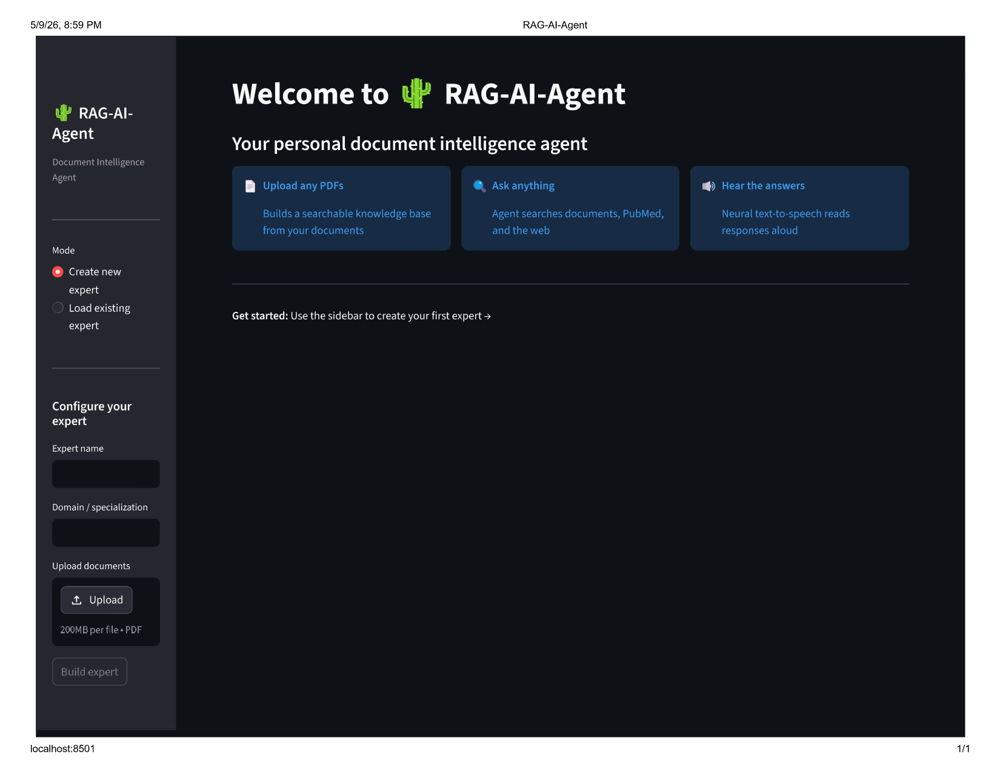
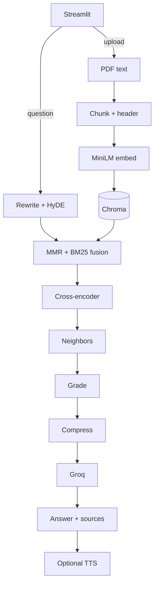
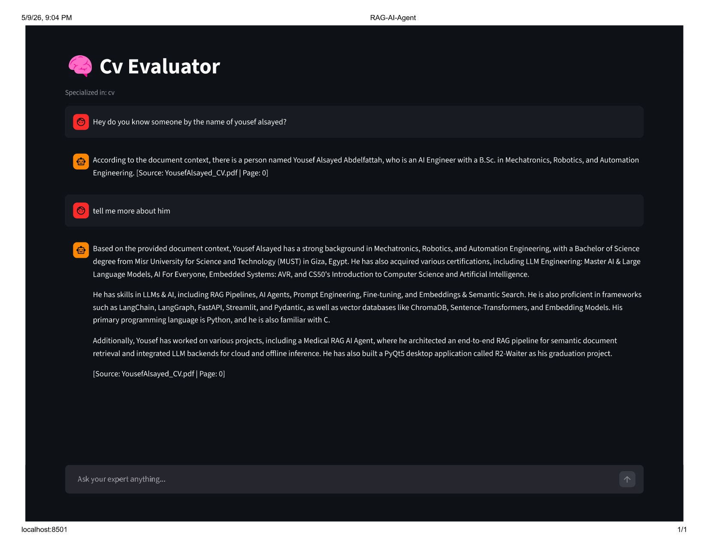

# RAG-AI-Agent

I built this so I can drop a pile of PDFs, name an expert, and ask questions that stay tied to those files. It is a Streamlit app: each expert is its own Chroma collection on disk, answers come from Groq, and every reply can show the page it came from.

I am **Yousef Alsayed**. This is my implementation, not a wrapper around a demo notebook.



## What I applied

The notebooks in [Nir Diamant's RAG Techniques](https://github.com/NirDiamant/RAG_Techniques) are the reference I used. I did not paste them in as-is. I rewrote the ones that fit this stack (LangChain, local Chroma, Groq, `all-MiniLM-L6-v2`) into the live ask path in `src/rag_pipeline.py` and `src/rag_utils.py`.

| Technique | Where it lives | Why I put it in |
| --- | --- | --- |
| Contextual chunk headers | `chunk_documents()` | The embedding sees `filename` and page, not a naked paragraph |
| Query rewrite, step-back, sub-queries | `plan_query()` | Follow-ups and vague questions search better after one cheap Groq call |
| HyDE | same call, then a second vector search | Hypothetical passage often matches the PDF wording better than the raw question |
| Fusion: vector MMR + BM25 | `retrieve_advanced()` | Drug names and dosages need keywords; the rest needs meaning |
| Cross-encoder rerank | `ms-marco-MiniLM-L-6-v2` | A local model reorders the fused pile before the LLM sees it |
| Neighbor window | `expand_with_neighbors()` | A hit is padded with the chunks next to it in the same file |
| CRAG-style grading | `grade_documents()` | Weak chunks get dropped instead of stuffed into the prompt |
| Extractive compression | `compress_chunk()` | Sentences that do not overlap the question get cut |

I left GraphRAG, RAPTOR, LightRAG, MemoRAG, ColPali, and Mistral OCR out on purpose. They need extra services or a different kind of document than a local PDF expert.

**Rebuild experts you created before this change.** Older collections do not have `seq_index` or headers, so neighbor expansion will not fire.

## What you can do

- Name a domain, upload text PDFs, build an expert.
- Load or delete collections from the sidebar.
- Ask questions; the answer is grounded in retrieved chunks, with filename, page, excerpt, and rerank score in **Sources**.
- Turn on Edge TTS if you want the answer spoken.
- Re-upload the same PDF: chunks upsert by content id instead of duplicating.

Scanned / image-only pages are skipped. EasyOCR is in the dependencies but not wired into ingestion yet.

## How a question is answered



1. Pages with no extractable text are dropped.
2. Remaining pages split at 1000 / 200 overlap, get a header and a `seq_index`.
3. Embeddings go into `vectorstore/` under that expert's collection.
4. On ask: plan the query, fuse MMR with BM25, rerank, expand neighbors, grade, compress, then Groq. Empty retrieval returns *"I couldn't find this in the provided documents."* and skips the model.

Agentic mode (PubMed, web, calculator) is still missing `src/tools.py`. The UI says so and stays on document RAG.

## Requirements

- Python 3.12+
- `GROQ_API_KEY`
- Network for Groq and Edge TTS
- Optional CUDA PyTorch for faster local embeddings

Dependencies are defined in `pyproject.toml` and locked in `uv.lock`. Ignore `requirements.txt`.

## Setup

```bash
uv sync
```

Windows:

```powershell
uv venv
.venv\Scripts\Activate.ps1
uv sync
```

macOS / Linux:

```bash
uv venv
source .venv/bin/activate
uv sync
```

`.env` in the repo root:

```env
GROQ_API_KEY=your_groq_api_key
```

| Variable | Default | Notes |
| --- | --- | --- |
| `GROQ_API_KEY` | required | App will not start without it |
| `MODEL_GPT_GROQ` | `llama-3.3-70b-versatile` | Answer model |
| `MODEL_AGENT_GROQ` | `llama-3.1-8b-instant` | Query plan and CRAG grading |

Knobs in `config.py` (not env): `retrieval_top_k` (4 after rerank), `retrieval_candidate_k` (12), `retrieval_fetch_k` (24), `context_neighbors` (1), `relevance_threshold` (0.35), `chunk_size` (1000), `chunk_overlap` (200).

## Run

```bash
uv run streamlit run app.py
```

[http://localhost:8501](http://localhost:8501)

Create an expert in the sidebar, or load one. Uploads land in `data/papers/`. Voice and Clear chat are in the sidebar once an expert is active.

## Screenshots





## Layout

```text
RAG-AI-Agent/
├── app.py
├── config.py
├── pyproject.toml
├── src/
│   ├── ingestion.py      # PDF → chunks → Chroma
│   ├── rag_utils.py      # headers, RRF, neighbors, compression
│   ├── rag_pipeline.py   # the techniques above, in order
│   ├── retriever.py      # ask_with_sources
│   ├── agent.py          # tool loop (tools module not in this checkout)
│   ├── llm.py
│   └── tts.py
├── tests/
└── ImagesForReadme/
```

```bash
uv run pytest
```

## If something breaks

- No start: missing `GROQ_API_KEY`.
- No Agentic toggle: `src/tools.py` is not in this checkout.
- Empty answers on a scanned PDF: there is no OCR path yet.
- Weird neighbors / weak retrieval on an old expert: rebuild it.
- TTS silent: Edge needs outbound network and the browser has to allow the audio element.

## Still to do

- Bring `src/tools.py` back (PubMed, web, calculator).
- OCR for scanned PDFs.
- Stream tokens into the chat.
- More tests around retrieval, not just chunk helpers.

## Author

**Yousef Alsayed** — [github.com/yousefattaff](https://github.com/yousefattaff)
