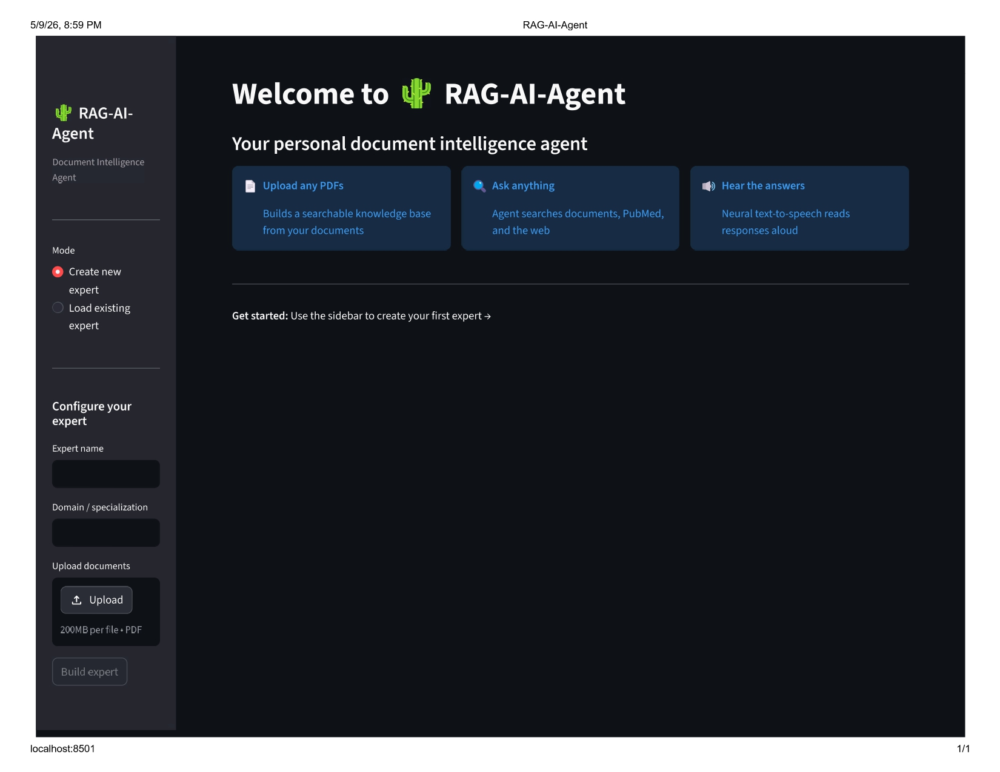
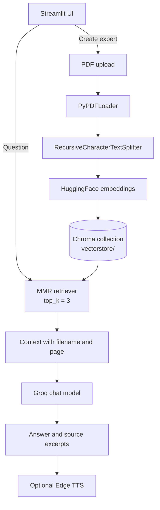
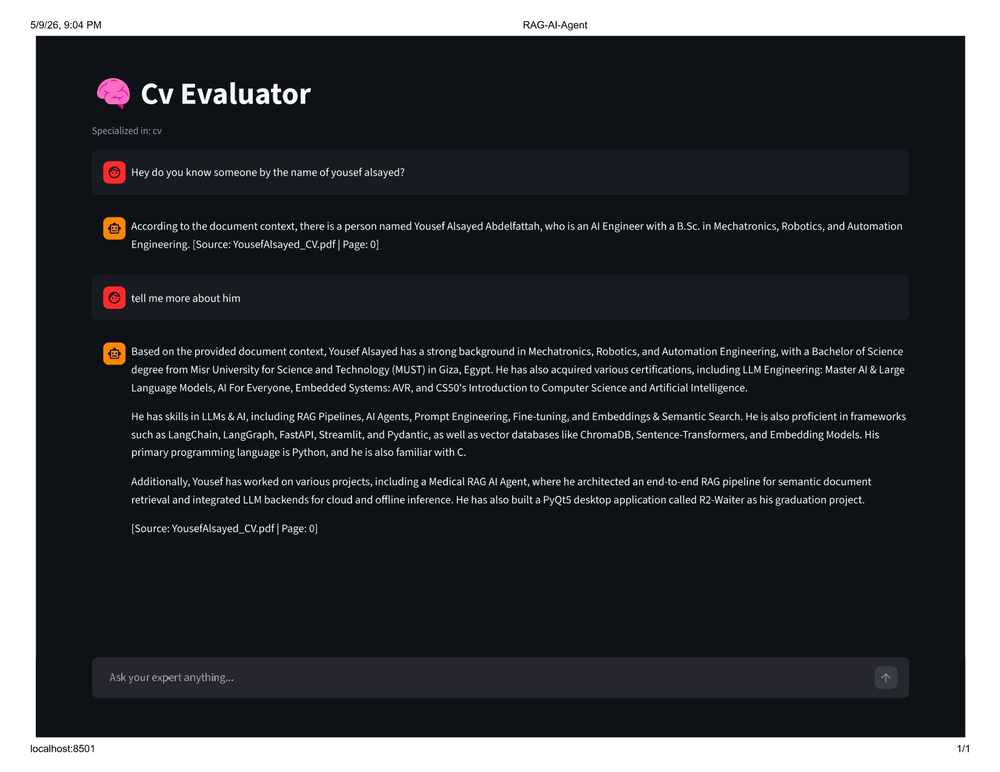

# RAG-AI-Agent

RAG-AI-Agent is a Streamlit prototype for turning uploaded, text-based PDFs into named expert knowledge bases. Each expert is stored in its own local Chroma collection and can answer questions with a Groq chat model using retrieved document chunks.



> **Implementation status:** the document-only RAG path is implemented and the app starts from a clean checkout. Ingestion is idempotent (re-uploading the same PDF updates its chunks instead of duplicating them). `src/agent.py` imports `STATIC_TOOLS` from `src.tools`, which is not present in this checkout; the import fails gracefully and **Agentic mode** is replaced by document-only RAG in the UI until that module is restored. This README documents the code that exists; it does not imply that the missing tools are currently available.

## Features

- Create an expert by naming a domain and uploading one or more PDFs.
- Load or delete existing expert collections from the sidebar.
- Extract embedded PDF text one page at a time with `PyPDFLoader`.
- Split pages into overlapping chunks and embed them locally with `all-MiniLM-L6-v2`.
- Persist embeddings in a local Chroma database under `vectorstore/`.
- Ask grounded questions through the document-only RAG path.
- Retrieve with Maximal Marginal Relevance so near-duplicate chunks don't crowd out other hits.
- Answer "not found in documents" without calling the model when retrieval returns nothing.
- Display retrieved filename, page number, and excerpt in a collapsible **Sources** panel.
- Optionally generate spoken responses with Microsoft Edge TTS.
- Switch between CPU and CUDA automatically for embedding generation when PyTorch detects a CUDA device.

The repository contains OCR-related dependencies, but ingestion currently uses `PyPDFLoader` only. Image-only/scanned PDFs therefore need an OCR pipeline before they can be searched; pages with no extractable text are now skipped with a warning instead of being ingested as empty chunks.

## How it works



### Document-only RAG

1. `ingest_pdf()` loads each PDF page, skipping pages without extractable text.
2. `chunk_documents()` splits pages using `chunk_size=1000` and `chunk_overlap=200`, tagging each chunk with its `chunk_index` within the page.
3. `embed_and_store()` writes normalized `all-MiniLM-L6-v2` embeddings to the selected Chroma collection under deterministic, content-derived IDs and removes prior IDs first — so re-ingesting the same PDF updates its chunks instead of duplicating them.
4. `ask_with_sources()` retrieves the three most relevant chunks with MMR, sends them to Groq with a document-only prompt, and returns the answer plus source metadata. If nothing relevant is retrieved it responds with "I couldn't find this in the provided documents." and skips the model call.

### Agent mode

`app.py` exposes an **Agentic mode** toggle and `src/agent.py` contains a bounded tool-calling loop. The intended tools are PubMed search, web search, and a medical calculator, but their implementation (`src/tools.py`) is not present in this checkout, so the toggle is replaced by a note and agent mode falls back to document-only answering. Agent answers also do not populate the structured Sources expander; the agent prompt instead asks the model to cite filename and page in its answer.

## Requirements

- Python 3.12 or newer.
- A Groq API key.
- Internet access for Groq and Edge TTS.
- Optional CUDA-capable PyTorch installation for faster local embeddings.

The supported dependency definition is `pyproject.toml`; `uv.lock` pins the resolved environment. `requirements.txt` is a legacy, less complete alternative and should not be used as the authoritative dependency list.

## Installation

From the repository directory:

```bash
uv sync
```

If `uv` is not installed, install it using the instructions at [docs.astral.sh/uv](https://docs.astral.sh/uv/), then run the command above.

### Windows virtual environment

```powershell
uv venv
.venv\Scripts\Activate.ps1
uv sync
```

### macOS or Linux virtual environment

```bash
uv venv
source .venv/bin/activate
uv sync
```

## Configuration

Create a `.env` file in the repository root. `config.py` loads it with Pydantic Settings.

### Required

| Variable | Default | Used by |
| --- | --- | --- |
| `GROQ_API_KEY` | — | `ChatGroq`; application startup fails without it |

Example:

```env
GROQ_API_KEY=your_groq_api_key
```

### Optional

| Variable | Default | Notes |
| --- | --- | --- |
| `MODEL_GPT_GROQ` | `llama-3.3-70b-versatile` | Model used by both `get_groq_llm()` call sites |
| `MODEL_AGENT_GROQ` | `llama-3.1-8b-instant` | Declared in settings, but not passed by `src/agent.py` |
| `ollama_base_url` | `http://localhost:11434` | Used only by the unused `get_ollama_llm()` factory |
| `ollama_model` | `llama3.2` | Used only by the unused `get_ollama_llm()` factory |

The following values are code-level settings in `config.py`, not environment variables:

| Setting | Default | Purpose |
| --- | ---: | --- |
| `embedding_model` | `all-MiniLM-L6-v2` | Local Hugging Face embedding model |
| `retrieval_top_k` | `3` | Number of chunks retrieved per question |
| `chunk_size` | `1000` | Maximum chunk size |
| `chunk_overlap` | `200` | Overlap between adjacent chunks |
| `max_agent_iterations` | `5` | Maximum tool-call loop iterations |

`TAVILY_API_KEY` is not read by the current `config.py`, and no `src/tools.py` implementation is present. Do not treat Tavily, PubMed, or calculator support as working features in this checkout.

## Running the application

```bash
uv run streamlit run app.py
```

Then open [http://localhost:8501](http://localhost:8501).

## Using the UI

1. In **Create new expert**, enter an expert name and domain, upload PDFs, and select **Build expert**.
2. The expert name is lowercased and spaces are replaced with underscores before it becomes the Chroma collection name.
3. Choose **Load existing expert** to select a collection already stored under `vectorstore/`.
4. Ask questions in the chat input.
5. Turn **Agentic mode** off to use the implemented document-only RAG path and see retrieved sources in the UI.
6. Turn on **Voice responses** to synthesize the answer with Edge TTS. Select a supported voice if needed.
7. Use **Clear chat** to reset the current conversation, or **Delete** to remove an expert collection.

Uploaded PDFs are written to `data/papers/`. The application creates `data/papers/` and `vectorstore/` automatically when `config.py` is imported.

## Screenshots

The repository includes screenshots of the current interface:





## Project layout

```text
RAG-AI-Agent/
├── app.py                    # Streamlit UI, expert management, chat, and TTS
├── config.py                 # Paths and Pydantic Settings
├── pyproject.toml            # Authoritative project metadata and dependencies
├── requirements.txt          # Legacy dependency list
├── uv.lock                   # Locked uv resolution
├── data/papers/              # Uploaded PDFs (created at runtime)
├── vectorstore/              # Persistent Chroma data (created at runtime)
├── ImagesForReadme/          # README screenshots
└── src/
    ├── ingestion.py          # PDF loading, chunking, embeddings, Chroma
    ├── retriever.py          # Document-only RAG chain and source formatting
    ├── agent.py              # Intended tool-calling agent path
    ├── llm.py                # Groq and Ollama factories
    └── tts.py                # Edge TTS and browser autoplay helpers
```

## Limitations and troubleshooting

- **The app does not start:** fixed — a clean checkout now imports even though `src/tools.py` is missing (the agent import degrades gracefully). If import still fails, confirm `.env` contains `GROQ_API_KEY`, which is required at startup.
- **Agent toggle is missing:** `src/tools.py` is not present in this checkout, so the UI shows a note and runs document-only RAG instead.
- **Scanned PDFs return little or no content:** only embedded PDF text is loaded; OCR is not wired into ingestion. Text-less pages are skipped with a warning.
- **No expert appears:** build at least one expert successfully and ensure the process can write to `data/papers/` and `vectorstore/`.
- **Answers fail at runtime:** verify `GROQ_API_KEY`, outbound network access, and the selected Groq model.
- **Voice output fails:** Edge TTS requires outbound network access and a browser that permits the generated audio element.
- **Repeated builds duplicate chunks:** fixed — ingestion uses content-derived IDs and replaces prior chunks for the same PDF (`src/ingestion.py:compute_chunk_id`); re-uploading the same file updates instead of appending.

## Roadmap

- Restore the agent tools module (`src/tools.py`) and its tests.
- Add an OCR or vision-based ingestion path for scanned PDFs.
- Add chat history: restate follow-up questions before retrieval instead of answering each message in isolation.
- Add hybrid retrieval (keyword + vectors) and cross-encoder reranking for exact-term searches such as drug names and dosages.
- Expose retrieval settings (top-k, fetch-k, chunk sizes) through environment configuration.
- Add streaming responses and automated tests for ingestion, retrieval, dedupe, and source citations.

## Author

**Yousef Alsayed**

- GitHub: [YousefAlsayed](https://github.com/yousefattaff)
